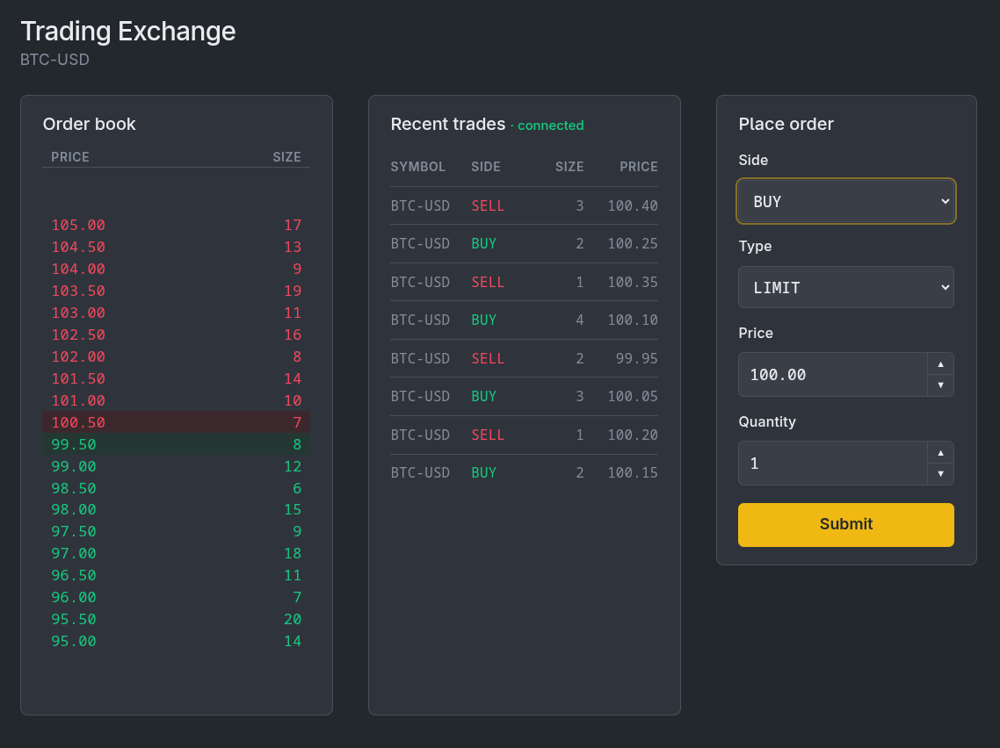

# Trading Exchange

A trading platform built for learning purposes, with a FastAPI backend and React frontend.

## Features

- Market and limit orders, partial fills, and an aggregated order book.
- REST and WebSocket order placement.
- User registration and JWT authentication with PyJWT.
- Order book snapshots and a live trade feed over WebSocket.
- Trade persistence handled by a separate worker through AWS SQS.
- SNS/SQS event delivery with local AWS resources initialized by Terraform.

## Stack

- **Backend** — Python, FastAPI, asyncio, SQLAlchemy, PostgreSQL, Alembic, PyJWT.
- **Frontend** — React, TypeScript, Vite.
- **Infrastructure** — Docker Compose, Terraform, LocalStack, AWS SQS and SNS.

## Run locally

Requires Docker with Compose and Make. Run from the project root.

On first run, copy `.env.example` to `.env` and set `JWT_SECRET_KEY` to a random
secret of at least 32 characters. Generate one with `openssl rand -hex 32`.

```bash
make up
```

The command builds the frontend, initializes LocalStack resources with Terraform,
and applies database migrations. The API and background worker (settlement) start 
after initialization succeeds. FastAPI serves the frontend.

After restarting Docker or rebooting the computer, run the following command
from the project root.

```bash
docker compose up -d
```

LocalStack persistence is disabled, so its AWS resources need to be recreated
after it restarts. Docker's automatic container restart does not run the one-off
Terraform service or enforce Compose startup dependencies. Running Compose again
starts Terraform to restore the resources.

- [Web interface](http://localhost:8000/)
- [API documentation](http://localhost:8000/docs)

Use **Sign in / Register** to create an account or sign in before placing orders.

View logs with `docker compose logs -f`. Stop the stack with
`docker compose down`.

## Authentication

REST order endpoints require `Authorization: Bearer <access_token>`. Register at
`POST /api/auth/register` and sign in at `POST /api/auth/login` using a JSON body
with `username` and `password`.

WebSocket connections authenticate using an HttpOnly access-token cookie and
validate `Origin`. On token expiry, the frontend calls `POST /api/auth/refresh`
and reconnects. The default access-token lifetime is 15 minutes; refresh tokens
expire after seven days.

Configure `WS_ALLOWED_ORIGINS` for origins other than `http://localhost:8000` and
`http://localhost:5173`. Set `AUTH_COOKIE_SECURE=true` when serving over HTTPS.

## Frontend development

With the backend running, start Vite separately for live reload.

```bash
cd frontend
npm ci
npm run dev
```

Open [localhost:5173](http://localhost:5173/). Vite proxies API and WebSocket
requests to the backend.
